# Entity Relationship Diagram

Generated from the JPA entities in `src/main/java/com/lexipal/core/entities`.
Enums are shown as field types, not separate entities.

```mermaid
erDiagram
    User {
        Long id PK
        String keycloakSub UK
        String nickname
        String nicknameNormalized UK
        LocalDateTime createdAt
        UserStatus status
        Integer totalPagesRead
        Integer totalBooksRead
        Integer totalXp
        Integer coinBalance
        Long selectedPortraitId FK
        Long selectedThemeId FK
    }

    Book {
        Long id PK
        String title
        String author
        Integer readPages
        Integer totalPages
        String coverImageUrl
        String coverSource
        String externalBookId
        LocalDateTime createdAt
        LocalDateTime completedAt
        BookStatus status
        Long userId FK
    }

    Session {
        Long id PK
        Long durationSeconds
        Integer startPage
        Integer endPage
        Integer pagesRead
        String reflection
        SessionStatus status
        LocalDateTime sessionDate
        LocalDateTime completedAt
        Long userId FK
        Long bookId FK
    }

    Note {
        Long id PK
        String quotedText
        Integer pageNumber
        String chapterLabel
        LocalDateTime createdAt
        Long userId FK
        Long bookId FK
        Long sourceSessionId
    }

    NoteTag {
        Long id PK
        Long userId FK
        String name
        String nameNormalized
        String colorHex
        LocalDateTime createdAt
        LocalDateTime updatedAt
    }

    NoteTagAssignment {
        Long id PK
        Long noteId FK
        Long tagId FK
        LocalDateTime assignedAt
    }

    Word {
        Long id PK
        String lemma UK
        Double rarityScore
        String source
        JsonNode definitions
        JsonNode phonetics
    }

    WordLookup {
        Long id PK
        Long wordId FK
        Long userId FK
        LocalDateTime firstLookedUpAt
        LocalDateTime lastLookedUpAt
        Integer lookupCount
        Long firstSourceSessionId
        Long lastSourceSessionId
    }

    Challenge {
        Long id PK
        ChallengeType type UK
        String description
        ChallengeDifficulty difficulty
    }

    ChallengeAttempt {
        Long id PK
        String userAnswer
        ChallengeResult result
        Integer xpAwarded
        LocalDateTime attemptedAt
        Long userId FK
        Long challengeId FK
        Long wordLookupId FK
        Long crosswordPuzzleId FK
    }

    CrosswordPuzzle {
        Long id PK
        Long userId FK
        Long challengeId FK
        CrosswordPuzzleStatus status
        LocalDateTime createdAt
        LocalDateTime submittedAt
        JsonNode publicPuzzle
        JsonNode solution
        JsonNode wordSources
    }

    DailyActivity {
        Long id PK
        LocalDate activityDate
        ActivityType activityType
        Integer xpEarned
        Long userId FK
        Long sessionId FK
        Long externalRefId
    }

    DailyQuest {
        Long id PK
        Long userId FK
        LocalDate questDate
        DailyQuestType type
        Integer targetValue
        Integer progressValue
        DailyQuestStatus status
        Integer xpReward
        Integer coinReward
        Integer baselineValue
        Long sourceSessionId FK
        LocalDateTime createdAt
        LocalDateTime completedAt
    }

    StreakMetaData {
        Long id PK
        Integer currentStreak
        Integer longestStreak
        LocalDate lastActivityDate
        Integer availableStreakFreezes
        LocalDate freezeProtectedThroughDate
        Long userId FK
    }

    CurrencyTransaction {
        Long id PK
        Long userId FK
        CurrencyTransactionType type
        CurrencyTransactionReason reason
        Integer amount
        Integer balanceAfter
        String sourceType
        Long sourceReferenceId
        LocalDateTime createdAt
    }

    BookCircle {
        Long id PK
        String inviteCode UK
        String bookTitle
        String bookAuthor
        Integer totalPages
        Integer memberCap
        CircleVisibility visibility
        CircleStatus status
        Long ownerUserId FK
        LocalDateTime createdAt
        LocalDateTime nextMeetingDate
        String meetingChapterLabel
        Integer meetingPageStart
        Integer meetingPageEnd
    }

    CircleMember {
        Long id PK
        Long circleId FK
        Long userId FK
        Long bookId FK
        CircleMemberRole role
        LocalDateTime joinedAt
    }

    CircleMemberBlock {
        Long id PK
        Long circleId FK
        Long userId FK
        Long blockedByUserId FK
        LocalDateTime blockedAt
    }

    CircleChatMessage {
        Long id PK
        Long circleId FK
        Long senderUserId FK
        String content
        LocalDateTime createdAt
        LocalDateTime deletedAt
        Long deletedByUserId FK
    }

    CatalogBook {
        Long id PK
        String title
        String author
        String titleNormalized
        String authorNormalized
        LocalDateTime createdAt
    }

    ReadingList {
        Long id PK
        String title
        String description
        Long ownerUserId FK
        ReadingListStatus status
        Integer starCount
        LocalDateTime createdAt
        LocalDateTime updatedAt
    }

    ReadingListBook {
        Long id PK
        Long listId FK
        Long catalogBookId FK
        Integer position
        String note
    }

    ReadingListGenre {
        Long id PK
        Long listId FK
        String genre
        String genreNormalized
    }

    ReadingListStar {
        Long id PK
        Long listId FK
        Long userId FK
        LocalDateTime starredAt
    }

    ReadingListSubscription {
        Long id PK
        Long listId FK
        Long userId FK
        LocalDateTime subscribedAt
        LocalDateTime completedAt
    }

    AchievementDefinition {
        Long id PK
        String code UK
        String category
        String title
        String description
        String metricKey
        Integer threshold
        Integer sortOrder
        Boolean active
    }

    UserAchievement {
        Long id PK
        Long userId FK
        Long achievementId FK
        LocalDateTime unlockedAt
        Integer progressValueAtUnlock
    }

    PortraitDefinition {
        Long id PK
        String code UK
        String name
        String description
        String assetKey
        Integer requiredLevel
        Integer sortOrder
        Boolean active
    }

    UserPortraitUnlock {
        Long id PK
        Long userId FK
        Long portraitId FK
        LocalDateTime unlockedAt
    }

    StoreItemDefinition {
        Long id PK
        String code UK
        String name
        String description
        StoreItemType itemType
        Integer priceCoins
        Integer sortOrder
        Boolean active
    }

    ThemeDefinition {
        Long id PK
        String code UK
        String name
        String description
        ThemeTone tone
        Integer sortOrder
        Boolean active
        Long storeItemId FK
    }

    UserThemeUnlock {
        Long id PK
        Long userId FK
        Long themeId FK
        LocalDateTime unlockedAt
    }

    PortraitDefinition |o--o{ User : selectedPortrait
    ThemeDefinition |o--o{ User : selectedTheme

    User |o--o{ Book : books
    User ||--o{ Session : sessions
    Book ||--o{ Session : sessions
    User ||--o{ Note : notes
    Book ||--o{ Note : notes
    User ||--o{ NoteTag : noteTags
    Note ||--o{ NoteTagAssignment : tagAssignments
    NoteTag ||--o{ NoteTagAssignment : assignments

    User ||--o{ WordLookup : wordLookups
    Word ||--o{ WordLookup : lookups

    User ||--o{ DailyActivity : dailyActivities
    Session |o--o{ DailyActivity : dailyActivities
    User ||--o{ DailyQuest : dailyQuests
    Session |o--o{ DailyQuest : sourceSession
    User ||--o| StreakMetaData : streakMetaData
    User ||--o{ CurrencyTransaction : currencyTransactions

    User ||--o{ ChallengeAttempt : challengeAttempts
    Challenge ||--o{ ChallengeAttempt : attempts
    WordLookup |o--o{ ChallengeAttempt : wordLookup
    CrosswordPuzzle |o--o{ ChallengeAttempt : crosswordPuzzle
    User ||--o{ CrosswordPuzzle : crosswordPuzzles
    Challenge ||--o{ CrosswordPuzzle : crosswordPuzzles

    User ||--o{ BookCircle : ownedCircles
    BookCircle ||--o{ CircleMember : members
    User ||--o{ CircleMember : circleMemberships
    Book ||--o{ CircleMember : circleBooks
    BookCircle ||--o{ CircleMemberBlock : memberBlocks
    User ||--o{ CircleMemberBlock : blockedUser
    User ||--o{ CircleMemberBlock : blockedBy
    BookCircle ||--o{ CircleChatMessage : chatMessages
    User ||--o{ CircleChatMessage : sentMessages
    User |o--o{ CircleChatMessage : deletedMessages

    User ||--o{ ReadingList : readingLists
    ReadingList ||--o{ ReadingListBook : books
    CatalogBook ||--o{ ReadingListBook : readingListSlots
    ReadingList ||--o{ ReadingListGenre : genres
    ReadingList ||--o{ ReadingListStar : stars
    User ||--o{ ReadingListStar : starredLists
    ReadingList ||--o{ ReadingListSubscription : subscriptions
    User ||--o{ ReadingListSubscription : subscriptions

    StoreItemDefinition |o--o| ThemeDefinition : storeItem
    User ||--o{ UserAchievement : achievements
    AchievementDefinition ||--o{ UserAchievement : unlockedBy
    User ||--o{ UserPortraitUnlock : portraits
    PortraitDefinition ||--o{ UserPortraitUnlock : unlocks
    User ||--o{ UserThemeUnlock : themes
    ThemeDefinition ||--o{ UserThemeUnlock : unlocks
```

## ID-only References

These fields look like cross-entity references, but they are plain IDs or polymorphic references in the Java model, so they are not drawn as hard JPA relationships:

- `Note.sourceSessionId`
- `WordLookup.firstSourceSessionId`
- `WordLookup.lastSourceSessionId`
- `DailyActivity.externalRefId`
- `CurrencyTransaction.sourceType` and `CurrencyTransaction.sourceReferenceId`
