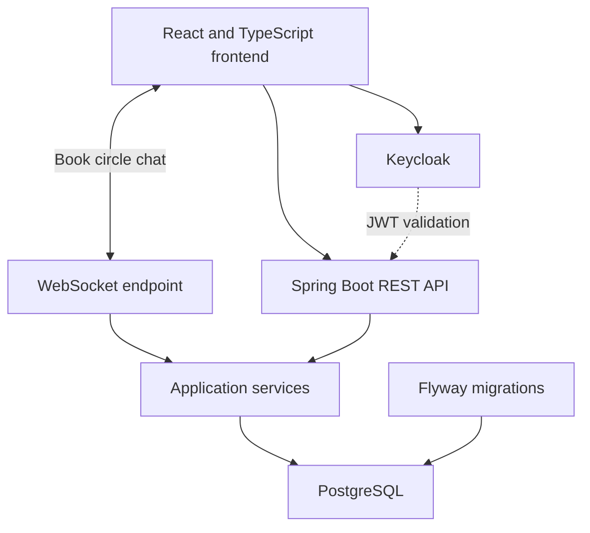

# Lexipal
### A reading companion built with Java and Spring Boot

Lexipal helps readers build a reading habit: organise books, record reading sessions, save notes and practise vocabulary. This repository contains the backend of my graduation project for the **Agile Java Developer programme at Edugrade**.

[Frontend](https://github.com/ErikEdman1996/FinalExam_Lexipal_Frontend) · [API controllers](src/main/java/com/lexipal/core/controllers) · [Tests](src/test/java/com/lexipal/core)

## What the application does

- **Personal library:** books, reading lists and reading progress.
- **Reading sessions:** session tracking, reflections, notes and tags.
- **Vocabulary practice:** saved word lookups, challenges and crossword puzzles.
- **Reading habits:** XP, streaks, achievements, daily quests and a reward wallet.
- **Book circles:** shared reading groups and WebSocket-based chat.
- **Authentication:** Keycloak sign-in, JWT validation and role-based admin access.

## Technology

| Area | Implementation |
| --- | --- |
| Language and framework | Java 21, Spring Boot 3.4 |
| API and persistence | Spring Web, Spring Data JPA, PostgreSQL |
| Database evolution | Flyway SQL migrations |
| Security | Spring Security, OAuth2 resource server, Keycloak |
| Realtime and caching | Spring WebSocket, Caffeine |
| Tests | JUnit, Spring Boot Test, MockMvc, H2 |
| Build and packaging | Maven Wrapper, multi-stage Docker build |

## Architecture



Controllers expose the API; services contain application logic; repositories handle persistence. Request and response DTOs keep the API separate from JPA entities.

## Run locally

You need **JDK 21**, PostgreSQL and a Keycloak instance. Maven is downloaded by the included wrapper on first use.

1. Clone this repository and create an empty PostgreSQL database called `lexipal_db`.
2. In Keycloak, create the `Lexipal_Realm` realm and configure the backend client `Lexipal_Backend`. Configure the frontend client using the [frontend instructions](https://github.com/ErikEdman1996/FinalExam_Lexipal_Frontend#run-locally). Client roles must match the JWT converter configuration.
3. Supply database credentials and the JWT issuer through your terminal or IDE environment.
4. Start the backend:

```bash
git clone https://github.com/ErikEdman1996/FinalExam_Lexipal.git
cd FinalExam_Lexipal
# Set the environment variables below before starting.
bash mvnw spring-boot:run
```

On Windows PowerShell, use `.\mvnw.cmd spring-boot:run` instead.

| Environment variable | Purpose / local value |
| --- | --- |
| `LEXIPAL_DB_URL` | `jdbc:postgresql://localhost:5432/lexipal_db` |
| `LEXIPAL_DB_USERNAME` | Your PostgreSQL user |
| `LEXIPAL_DB_PASSWORD` | Your PostgreSQL password |
| `LEXIPAL_JWT_ISSUER_URI` | `http://localhost:8080/realms/Lexipal_Realm` |
| `JWT_RESOURCE_ID_NAME` | `Lexipal_Backend` |
| `LEXIPAL_ALLOWED_ORIGINS` | `http://localhost:5173` |
| `SERVER_PORT` | `8585` (overridden by `PORT` when set) |

The backend starts at **http://localhost:8585**. Flyway runs the checked-in migrations and Hibernate validates the schema. The health endpoint is `GET /actuator/health`; application endpoints use `/lexipal/api/v1` and require a valid bearer token. Admin routes additionally require the admin role.

Spring Boot does not automatically load a root `.env` file. Export variables or configure them in your IDE. Keycloak realm/client exports and a complete local Compose stack are not included.

## Build and test

```bash
bash mvnw test
bash mvnw verify
docker build -t lexipal-backend .
```

On PowerShell, replace `bash mvnw` with `.\mvnw.cmd`.

Integration tests based on `IntegrationTestBase` use the `test` profile, H2 and mocked JWT authentication. They cover API behaviour without using the normal PostgreSQL database. See [test configuration](src/test/resources/application-test.properties). The Docker build skips tests; run the Maven checks separately.

## Explore the code

| Directory | Responsibility |
| --- | --- |
| [controllers](src/main/java/com/lexipal/core/controllers) | REST endpoints |
| [services](src/main/java/com/lexipal/core/services) | Reading, vocabulary and progression logic |
| [repositories](src/main/java/com/lexipal/core/repositories) | Data access |
| [configs](src/main/java/com/lexipal/core/configs) | Security, WebSocket and application configuration |
| [db/migration](src/main/resources/db/migration) | Versioned database schema |
| [src/test](src/test) | Unit and integration tests |

## Project context

Graduation project and continuing portfolio work by **Erik Edman**. The repository shows the current implementation, including work added after the original examination. External services must be configured before running the full application.

[GitHub profile](https://github.com/ErikEdman1996) · [LinkedIn](https://www.linkedin.com/in/erik-edman-b98a12395/)
